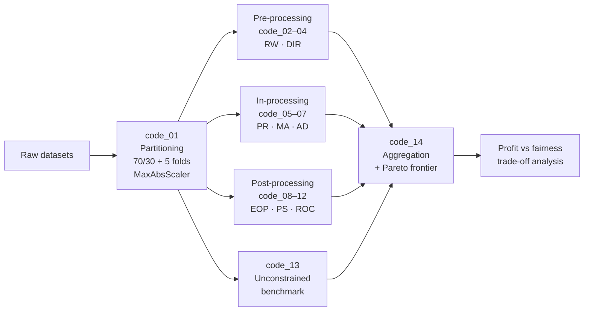

# Fairness and Profitability in Machine Learning Credit Scoring

> **Master's thesis project** — an empirical study of the trade-off between **algorithmic fairness** and **financial profitability** in ML-based retail credit scoring.
>
> **Author:** Alessandro Pistoia · **Reference paper:** Kozodoi, Jacob & Lessmann (2022), *European Journal of Operational Research*
>
> 🇮🇹 [Versione italiana](README_IT.md)


---

## Table of contents

1. [Why this matters](#-why-this-matters)
2. [Research questions](#-research-questions)
3. [What I did — at a glance](#-what-i-did--at-a-glance)
4. [Fairness criteria](#-fairness-criteria)
5. [Fairness processors compared](#-fairness-processors-compared)
6. [Data](#-data)
7. [Experimental pipeline](#-experimental-pipeline)
8. [Key findings](#-key-findings)
9. [Managerial and regulatory implications](#-managerial-and-regulatory-implications)
10. [Repository structure](#-repository-structure)
11. [How to reproduce](#-how-to-reproduce)
12. [Skills demonstrated](#-skills-demonstrated)
13. [References and credits](#-references-and-credits)

Detailed documentation lives in [`docs/`](docs/):
[methodology](docs/methodology.md) · [code pipeline](docs/pipeline.md) · [results](docs/results.md) · [regulatory context](docs/regulatory_context.md)

---

## 💡 Why this matters

Banks increasingly use machine learning scorecards to decide **who gets a loan**. These models are trained on historical data, so they can inherit and amplify past discrimination against groups defined by a *protected attribute* (age, gender, ethnicity…).

Fixing this is not free: constraining a model to be fair usually changes **which applicants are accepted**, and therefore **how much money the lender makes**. Lenders, regulators and data scientists need a quantitative answer to a simple question:

> **How much profit does a bank have to give up to make its credit scoring model fair — and which technique gets there most cheaply?**

## ❓ Research questions

| # | Question |
|---|----------|
| RQ1 | Which **statistical fairness criterion** (Independence, Separation, Sufficiency) is most appropriate for credit scoring? |
| RQ2 | How do the criteria **relate to each other** and to classic performance (AUC) and profit metrics? |
| RQ3 | Which **fairness processor** (pre-, in- or post-processing) offers the best profit–fairness balance? |
| RQ4 | What is the **monetary cost** of reducing algorithmic discrimination to a given level? |

## 🧭 What I did — at a glance

- 📚 **Literature review** of fair ML and credit scoring, organised in a structured comparison table (criteria, techniques, datasets, findings).
- ⚖️ **Formalised three fairness criteria** and assessed their suitability for lending, taking into account the *asymmetric costs* of credit errors.
- 🛠️ **Ran an end-to-end experimental pipeline of 16 scripts** (Python + R) covering data partitioning, **8 fairness processors**, an **unconstrained benchmark** and the final aggregation.
- 🤖 Trained and tuned **4 base classifiers**: Logistic Regression, Random Forest, XGBoost, Neural Network.
- 💶 Evaluated every model on **AUC, profit (EMP and profit per euro lent)** and **three fairness metrics**, with **5-fold cross-validation**.
- 📈 Built **Pareto frontiers** (profit vs. Separation) to isolate non-dominated solutions and estimate the cost of fairness.
- 🏛️ Linked the results to **US ECOA, EU GDPR and the EU AI Act (2024)**.

## ⚖️ Fairness criteria

Protected attribute: **AGE** — *unprivileged* group `< 25 years`, *privileged* group `≥ 25 years`.

| Criterion | Also known as | Requirement | Verdict for credit scoring |
|-----------|---------------|-------------|----------------------------|
| **Independence (IND)** | Demographic / statistical parity | Same **acceptance rate** across groups. In practice relaxed by the **80% rule** (disparate impact ratio ≥ 0.8). | Ignores actual repayment ability; may force bad loans. |
| **Separation (SP)** | Equalized odds | Same **error rates** (FPR and FNR) across groups. | ✅ **Most suitable** — respects the asymmetric costs of misclassification for both lender and borrower. |
| **Sufficiency (SF)** | Predictive parity / calibration | Same **positive predictive value** (PPV) across groups. | Often achieved "for free" by well-calibrated models; weak at correcting historical bias. |

Formal definitions, the metrics used and the reasoning behind the choice of Separation are in [`docs/methodology.md`](docs/methodology.md).

## 🛠️ Fairness processors compared

Eight techniques, placed at different stages of the modelling pipeline, plus an unconstrained benchmark:

| Stage | Processor | Code | Idea |
|-------|-----------|------|------|
| Pre-processing | **Reweighing** | RW | Reweights observations so that group and label become statistically independent. |
| Pre-processing | **Disparate Impact Remover** | DIR | Quantile-repairs feature distributions so the protected attribute can't be predicted (repair level λ ∈ {0.5,…,1.0}). |
| In-processing | **Prejudice Remover** | PR | Adds a *prejudice-index* regulariser (weight η) to the loss function. |
| In-processing | **Meta-Fair Classifier** | MA | Optimises under an explicit constraint on a group metric (τ ∈ [0.05, 0.30]). |
| In-processing | **Adversarial Debiasing** | AD | A predictor network learns Y while an adversary tries to recover AGE from its output. |
| Post-processing | **Equalized Odds Post-processing** | EOP | Group-specific thresholds that equalise TPR and FPR. |
| Post-processing | **Platt Scaling** | PS | Group-specific logistic calibration of scores (targets Sufficiency). |
| Post-processing | **Reject Option Classification** | ROC | Flips uncertain decisions near the threshold in favour of the unprivileged group. |
| Benchmark | **Unconstrained** | — | Same 4 classifiers optimised for profit/AUC only — the baseline for all comparisons. |

## 🗃️ Data

The reference framework uses seven real-world retail credit datasets of very different size and default rate:

| Dataset | Observations | Used in thesis |
|---------|-------------:|:--------------:|
| German Credit | 1,000 | ✅ |
| Bene | 3,123 | — |
| Taiwan Credit | 23,531 | ✅ |
| UK | 30,000 | ✅ |
| PAKDD | 50,000 | ✅ |
| GMSC (Give Me Some Credit) | 150,000 | — |
| Home Credit | 307,511 | — |

The final comparative analysis of the thesis was run on **4 datasets: German Credit, Taiwan Credit, UK and PAKDD**. Raw data are **not** included in this repository (licensing): see [`data/README.md`](data/README.md) for sources and the expected folder layout.

**Preparation:** 70/30 train–test split · 5-fold cross-validation inside the training set · `MaxAbsScaler` normalisation to [-1, 1] (preserves sparsity) · binary `AGE` group attribute.

## 🔄 Experimental pipeline



| Phase | Scripts | Language | What happens |
|-------|---------|----------|--------------|
| 0 · Setup | `code_00_working_paths` | Py / R | Defines and creates the project folder structure. |
| 1 · Partitioning | `code_01_partitioning.ipynb` | Python | Load data, define AGE groups, split, scale, export `.csv` / `.pkl`. |
| 2 · Pre-processing | `code_02` → `code_04` | Py → R | RW and DIR in AIF360; train 4 classifiers in `caret`; tune λ on validation EMP. |
| 3 · In-processing | `code_05` → `code_07` | Py → R | PR, MA, AD in AIF360; parameter tuning and EMP-optimal cut-off in R. |
| 4 · Post-processing | `code_08` → `code_12` | R / Py | Base scores → EOP, Platt Scaling, Reject Option Classification → evaluation. |
| 5 · Benchmark & results | `code_13`, `code_14` | R | Unconstrained baseline; merge all results; Pareto frontiers. |

Script-by-script details, including the R helper functions (`evaluate()`, `fairness_metric()`, `emp_summary()`, `compute_profit()`, …), are in [`docs/pipeline.md`](docs/pipeline.md).

## 📊 Key findings

| # | Finding |
|---|---------|
| 1 | **Separation is the most appropriate criterion** for credit scoring: it equalises error rates across age groups while acknowledging the different costs of false approvals and false rejections. |
| 2 | Metrics move together: **AUC ↔ profit correlation ≈ 0.80**, **Independence ↔ Separation correlation ≈ 0.95** — several criteria can be approximately satisfied at once. |
| 3 | **Fairness is cheap up to a point**: bringing the error-rate gap (Separation) **below 0.2** costs **< 5% of profit on average** — less than **€0.01 per euro lent**. |
| 4 | **Perfect fairness is expensive**: eliminating discrimination entirely requires sacrificing **more than 35% of profit**. |
| 5 | **In-processing (Prejudice Remover)** and **post-processing (Reject Option Classification)** give the best practical balance between ease of deployment and profit protection. |

More detail in [`docs/results.md`](docs/results.md).

## 🏛️ Managerial and regulatory implications

- Lenders can **substantially reduce age discrimination at a modest cost** — fairness and profitability are not mutually exclusive.
- **Post-processing** methods can be bolted onto an existing scorecard without retraining, which lowers the barrier to adoption.
- The study supports **fairness-by-design** as required by the **EU AI Act (2024)**, which classifies credit scoring as a *high-risk* AI system, and is consistent with **US ECOA** (80% rule) and **GDPR** principles.

See [`docs/regulatory_context.md`](docs/regulatory_context.md).

## 📂 Repository structure

```
tesi_magistrale/
├── README.md               ← you are here (EN)
├── README_IT.md            ← Italian version
├── docs/
│   ├── methodology.md      ← fairness criteria, processors, profit metrics
│   ├── pipeline.md         ← script-by-script description (code_00 → code_14)
│   ├── results.md          ← findings and interpretation
│   └── regulatory_context.md
├── src/
│   └── fairness_metrics.py ← standalone Python implementation of IND / SP / SF + profit
├── tests/
│   └── test_fairness_metrics.py
├── codes/                  ← experiment scripts (.ipynb / .R) — see codes/README.md
├── functions/              ← R helper functions — see functions/README.md
├── data/                   ← raw/ and prepared/ (not versioned) — see data/README.md
├── results/                ← intermediate/ and final/ outputs — see results/README.md
└── requirements.txt
```

## ▶️ How to reproduce

```bash
git clone https://github.com/PistoiaAlessandro/tesi_magistrale.git
cd tesi_magistrale

# Python environment
python -m venv .venv && source .venv/bin/activate
pip install -r requirements.txt

# quick check of the metric implementations
pytest -q
```

```r
# R environment
install.packages(c("caret", "EMP", "ROCR", "randomForest", "xgboost", "nnet",
                   "doParallel", "dplyr", "ggplot2"))
```

1. Download the datasets into `data/raw/` (see [`data/README.md`](data/README.md)).
2. Run the scripts in `codes/` **in numerical order** (`code_00` → `code_14`), switching between Jupyter (Python) and RStudio (R) as indicated in [`docs/pipeline.md`](docs/pipeline.md).
3. Final tables and Pareto plots are written to `results/final/`.

**Example — fairness metrics in Python:**

```python
import numpy as np
from src.fairness_metrics import fairness_report

y_true = np.array([1, 0, 1, 1, 0, 1, 0, 1])   # 1 = good payer
y_pred = np.array([1, 0, 1, 0, 0, 1, 1, 1])   # 1 = loan accepted
age_group = np.array([0, 0, 0, 0, 1, 1, 1, 1])   # 0 = <25 (unprivileged), 1 = ≥25

print(fairness_report(y_true, y_pred, age_group))
```

## 🧠 Skills demonstrated

| Area | Details |
|------|---------|
| Machine learning | Logistic regression, random forest, XGBoost, neural networks; hyper-parameter grids; cross-validation |
| Responsible AI | Group fairness metrics, pre/in/post-processing debiasing, adversarial learning |
| Business analytics | Profit-based evaluation (EMP), cost-sensitive thresholds, profit per euro lent |
| Multi-objective analysis | Pareto frontiers, non-dominated solution filtering |
| Tooling | Python (pandas, scikit-learn, AIF360), R (caret, EMP, ROCR), Jupyter, RStudio |
| Research | Systematic literature review, experimental design, regulatory analysis (ECOA, GDPR, EU AI Act) |

## 📖 References and credits

This thesis builds on and replicates the open-source experimental framework published with:

- **Kozodoi, N., Jacob, J., & Lessmann, S. (2022).** *Fairness in credit scoring: Assessment, implementation and profit implications.* European Journal of Operational Research, 297(3), 1083–1094. [doi:10.1016/j.ejor.2021.06.023](https://doi.org/10.1016/j.ejor.2021.06.023) · [original code](https://github.com/kozodoi/Fair_Credit_Scoring)

Further references:

- Verbraken, T., Bravo, C., Weber, R., & Baesens, B. (2014). *Development and application of consumer credit scoring models using profit-based classification measures.* EJOR, 238(2), 505–513.
- Bellamy, R. K. E. et al. (2018). *AI Fairness 360: An extensible toolkit for detecting, understanding, and mitigating unwanted algorithmic bias.* IBM Research.
- Hurlin, C. et al. (2024) and Valdrighi, G. et al. (2025) — recent work on fairness in credit scoring discussed in the thesis.
- Regulation (EU) 2024/1689 — *Artificial Intelligence Act*.

---

**Author:** Alessandro Pistoia · [GitHub](https://github.com/PistoiaAlessandro)
