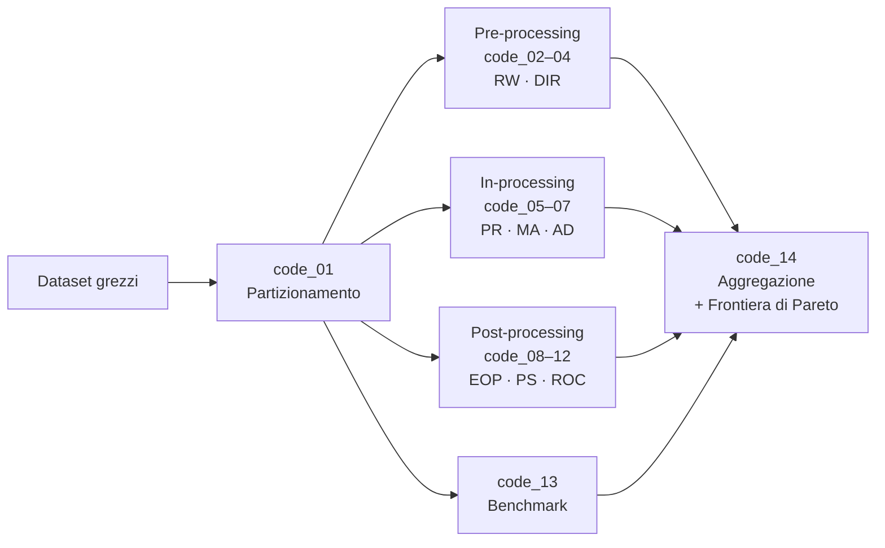

# Fairness e Redditività nel Credit Scoring con Machine Learning

> **Progetto di tesi magistrale** — studio empirico del trade-off tra **equità algoritmica** (*fairness*) e **redditività finanziaria** nei modelli di credit scoring basati su Machine Learning.
>
> 🇬🇧 [English version](README.md)

---

## 💡 Perché è importante

Le banche usano sempre più spesso modelli di machine learning per decidere **a chi concedere un prestito**. Questi modelli imparano dai dati storici e possono quindi ereditare e amplificare discriminazioni passate verso gruppi definiti da un *attributo protetto* (età, genere, etnia…).

Correggere il modello ha un costo: un vincolo di equità cambia **quali clienti vengono accettati** e quindi **quanto guadagna la banca**. La domanda centrale della tesi è:

> **Quanto profitto deve sacrificare una banca per rendere equo il proprio modello di scoring — e quale tecnica permette di farlo al costo minore?**

## ❓ Domande di ricerca

| # | Domanda |
|---|---------|
| RQ1 | Quale **criterio statistico di fairness** (Independence, Separation, Sufficiency) è più adatto al credit scoring? |
| RQ2 | Come si **relazionano** i criteri tra loro e con le metriche di performance (AUC) e di profitto? |
| RQ3 | Quale **fairness processor** (pre-, in- o post-processing) offre il miglior equilibrio profitto–equità? |
| RQ4 | Qual è il **costo monetario** per ridurre la discriminazione algoritmica a un dato livello? |

## 🧭 Il lavoro in sintesi

- 📚 **Literature review** su fair ML e credit scoring, organizzata in una tabella comparativa strutturata.
- ⚖️ **Formalizzazione di tre criteri di fairness** e valutazione della loro idoneità al credito, considerando l'*asimmetria dei costi* degli errori.
- 🛠️ **Pipeline sperimentale di 16 script** (Python + R): partizionamento, **8 fairness processor**, **benchmark non vincolato** e aggregazione finale.
- 🤖 **4 classificatori base**: Regressione Logistica, Random Forest, XGBoost, Rete Neurale.
- 💶 Valutazione su **AUC, profitto (EMP e profitto per euro erogato)** e **tre metriche di fairness**, con **cross-validation a 5 fold**.
- 📈 **Frontiere di Pareto** (profitto vs. Separation) per isolare le soluzioni non dominate e stimare il costo dell'equità.
- 🏛️ Collegamento dei risultati a **US ECOA, GDPR e EU AI Act (2024)**.

## ⚖️ Criteri di fairness

Attributo protetto: **AGE** — gruppo *non privilegiato* `< 25 anni`, gruppo *privilegiato* `≥ 25 anni`.

| Criterio | Noto anche come | Requisito | Valutazione per il credit scoring |
|----------|-----------------|-----------|-----------------------------------|
| **Independence (IND)** | Demographic parity | Stesso **tasso di approvazione** tra i gruppi; nella pratica rilassato dalla **regola dell'80%**. | Ignora la reale capacità di rimborso. |
| **Separation (SP)** | Equalized odds | Stessi **tassi di errore** (FPR e FNR) tra i gruppi. | ✅ **Il più idoneo** — rispetta l'asimmetria dei costi per banca e cliente. |
| **Sufficiency (SF)** | Predictive parity | Stesso **Positive Predictive Value** (PPV) tra i gruppi. | Spesso ottenuto automaticamente dai modelli calibrati; poco efficace contro le discriminazioni storiche. |

Definizioni formali in [`docs/methodology.md`](docs/methodology.md).

## 🛠️ Fairness processor confrontati

| Fase | Processor | Sigla | Idea |
|------|-----------|-------|------|
| Pre-processing | **Reweighing** | RW | Ripesa le osservazioni per rendere indipendenti gruppo ed etichetta. |
| Pre-processing | **Disparate Impact Remover** | DIR | Trasforma i quantili delle feature (λ ∈ {0.5,…,1.0}). |
| In-processing | **Prejudice Remover** | PR | Regolarizzazione con l'indice di pregiudizio (peso η). |
| In-processing | **Meta-Fair Classifier** | MA | Vincolo esplicito su una metrica di gruppo (τ ∈ [0.05, 0.30]). |
| In-processing | **Adversarial Debiasing** | AD | Predictor vs. Adversary che cerca di ricostruire AGE. |
| Post-processing | **Equalized Odds Post-processing** | EOP | Soglie per gruppo che pareggiano TPR e FPR. |
| Post-processing | **Platt Scaling** | PS | Calibrazione logistica separata per gruppo. |
| Post-processing | **Reject Option Classification** | ROC | Riassegna le decisioni incerte a favore del gruppo svantaggiato. |
| Benchmark | **Unconstrained** | — | Modelli ottimizzati solo per profitto/AUC. |

## 🗃️ Dati

| Dataset | Osservazioni |
|---------|-------------:|
| German Credit | 1.000 |
| Bene | 3.123 |
| Taiwan Credit | 23.531 |
| UK | 30.000 |
| PAKDD | 50.000 |
| GMSC | 150.000 |
| Home Credit | 307.511 |

L'analisi comparativa finale è stata condotta sui **4 dataset accessibili pubblicamente**. Preparazione: split 70/30, 5 fold di cross-validation, normalizzazione `MaxAbsScaler` in [-1, 1]. Fonti in [`data/README.md`](data/README.md).

## 🔄 Pipeline sperimentale



Descrizione script per script in [`docs/pipeline.md`](docs/pipeline.md).

## 📊 Risultati principali

| # | Risultato |
|---|-----------|
| 1 | **Separation è il criterio più adatto** al credit scoring. |
| 2 | Correlazione **AUC ↔ profitto ≈ 0,80** e **Independence ↔ Separation ≈ 0,95**. |
| 3 | Ridurre la differenza nei tassi d'errore **sotto 0,2** costa in media **meno del 5% del profitto** (meno di **€0,01 per euro erogato**). |
| 4 | Eliminare del tutto la discriminazione richiede un sacrificio **superiore al 35% del profitto**. |
| 5 | **Prejudice Remover** (in-processing) e **Reject Option Classification** (post-processing) offrono il miglior equilibrio pratico. |

Approfondimento in [`docs/results.md`](docs/results.md).

## 🏛️ Implicazioni manageriali e normative

- La discriminazione per età può essere **ridotta in modo sostanziale a un costo contenuto**.
- Il **post-processing** si applica a uno scorecard esistente senza riaddestrarlo.
- I risultati supportano l'approccio di **fairness by design** richiesto dall'**EU AI Act (2024)**, che classifica il credit scoring come sistema *ad alto rischio*.

## ▶️ Come riprodurre

```bash
git clone https://github.com/PistoiaAlessandro/tesi_magistrale.git
cd tesi_magistrale
pip install -r requirements.txt
pytest -q
```

Poi: scaricare i dati in `data/raw/` ed eseguire gli script di `codes/` in ordine numerico (`code_00` → `code_14`).

## 📖 Riferimenti

La tesi si basa sul framework sperimentale open-source di:

- **Kozodoi, N., Jacob, J., & Lessmann, S. (2022).** *Fairness in credit scoring: Assessment, implementation and profit implications.* European Journal of Operational Research, 297(3), 1083–1094. [doi:10.1016/j.ejor.2021.06.023](https://doi.org/10.1016/j.ejor.2021.06.023) · [codice originale](https://github.com/kozodoi/Fair_Credit_Scoring)

Altri riferimenti nel [README in inglese](README.md#-references-and-credits).

---

**Autore:** Alessandro Pistoia · [GitHub](https://github.com/PistoiaAlessandro)
