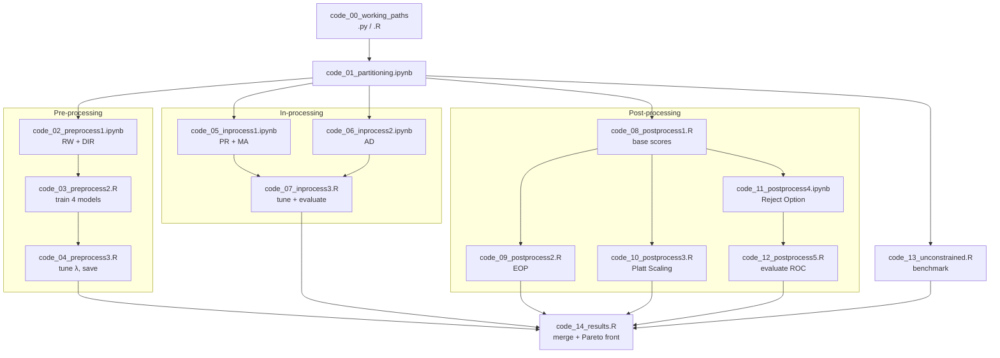

# Code pipeline — script by script

← [Back to README](../README.md)

The experiment consists of **16 execution scripts** (Jupyter notebooks and R scripts) that must run **in numerical order**. Python is used where the fairness algorithms come from **AIF360** (partitioning, pre-processing, most in-processing, Reject Option Classification); R is used for model training and tuning with **caret**, profit evaluation with **EMP**, and the final Pareto analysis.

## Folder layout used by the scripts

| Folder | Content |
|--------|---------|
| `codes/` | the 16 execution scripts and auxiliary files |
| `functions/` | modular R helpers (profit, evaluation, training settings) sourced by the scripts |
| `data/raw/` | original datasets |
| `data/prepared/` | train / validation / test splits and CV folds (`.csv` and `.pkl`) |
| `results/intermediate/` | per-processor predictions (e.g. `PR_predictions_*.csv`, `MA_predictions_*.csv`) |
| `results/final/` | aggregated metrics and plots |
| `output/` | intermediate HTML reports |

---

## Phase 0 — Setup

### `code_00_working_paths.py` / `code_00_working_paths.R`
Defines the project root and creates the folder structure above, so that every subsequent script reads and writes with relative paths.

## Phase 1 — Partitioning

### `code_01_partitioning.ipynb` · Python
- Loads the raw datasets and builds the protected attribute **AGE** (`< 25` → unprivileged, `≥ 25` → privileged).
- Splits into **training (70%)** and **test (30%)** sets and creates **5 cross-validation folds** in the training data.
- Scales features with **`MaxAbsScaler`** into [-1, 1]: unlike standardisation it does not shift the data, so sparse / zero-heavy columns (common after one-hot encoding) stay sparse.
- Saves the prepared data as `.csv` (for R) and `.pkl` (for Python) in `data/prepared/`.

## Phase 2 — Pre-processing

### `code_02_preprocess1.ipynb` · Python
- **Reweighing (RW):** computes instance weights from observed vs. expected group–label frequencies.
- **Disparate Impact Remover (DIR):** repairs feature distributions; produces **6 versions** of each dataset, one per repair level $\lambda \in \{0.5, 0.6, 0.7, 0.8, 0.9, 1.0\}$.

### `code_03_preprocess2.R` · R
Trains the 4 base classifiers (`glm`, `rf`, `xgbTree`, `nnet`) on the RW-weighted and DIR-repaired data, sourcing the helper functions below.

### `code_04_preprocess3.R` · R
Selects, for DIR, the repair level $\lambda$ that **maximises EMP on the validation folds**, then stores the final pre-processing results.

## Phase 3 — In-processing

### `code_05_inprocess1.ipynb` · Python
- **Prejudice Remover (PR):** grid over the regularisation weight $\eta$.
- **Meta-Fair Classifier (MA):** grid over the constraint parameter $\tau \in [0.05, 0.30]$.
- Exports predictions to `results/intermediate/` (`PR_predictions_*.csv`, `MA_predictions_*.csv`).

### `code_06_inprocess2.ipynb` · Python
- **Adversarial Debiasing (AD):** predictor + adversary networks trained for **50 epochs**; the classifier batch loss and the adversarial batch loss are logged to monitor convergence towards Separation.

### `code_07_inprocess3.R` · R
Tunes PR, MA and AD on validation EMP, applies the **EMP-optimal cut-off (`EMPfrac`)** and evaluates the final models with `evaluate()`.

## Phase 4 — Post-processing

### `code_08_postprocess1.R` · R
Trains the base classifiers on unconstrained data and stores the predicted probabilities of the "good" class, which are the input of every post-processor.

### `code_09_postprocess2.R` · R — Equalized Odds Post-processing
Builds a separate ROC curve per age group and finds the group-specific thresholds that equalise **TPR** and **FPR**.

### `code_10_postprocess3.R` · R — Platt Scaling
Fits a **separate logistic regression per group** on the raw scores, so that predicted probabilities reflect the real default risk in each group (targets Sufficiency).

### `code_11_postprocess4.ipynb` · Python — Reject Option Classification
Defines a critical region of width $\theta \in \{0.1, 0.2, 0.3\}$ around the threshold and reassigns the uncertain decisions in favour of the `< 25` group.

### `code_12_postprocess5.R` · R
Evaluates the ROC-corrected predictions: accuracy, disparate impact, equal opportunity difference, average odds difference and EMP profit.

## Phase 5 — Benchmark and results

### `code_13_unconstrained.R` · R
**Unconstrained benchmark:** the 4 base classifiers tuned only for profit / AUC, with no fairness intervention. This is the reference point for measuring the profit loss and fairness gain of each processor.

### `code_14_results.R` · R
- Merges all intermediate results (datasets × 5 folds × 4 base models × 8 processors) into the final comparison table.
- Calls `PlotParetoFront()` (function 93) and the `nondominated` routine to plot the **Pareto frontier** of *profit per euro lent* vs. *Separation*.
- Computes the **average profit loss** required to reach given fairness targets.

---

## R helper functions (`functions/`)

| File | Function | Purpose |
|------|----------|---------|
| `93_*` | `PlotParetoFront()` | Plots the profit–fairness Pareto frontier with non-dominated points |
| `94_evaluate.R` | `evaluate()` | One call → AUC, EMP, IND, SP, SF for a set of predictions |
| `95_fairness_metrics.R` | `fairness_metric()` | Group disparities for a chosen criterion |
| `96_emp_summary.R` | `emp_summary()` | Wraps `EMP::empCreditScoring()` and summarises EMP / EMPfrac |
| `97_caret_settings.R` | `caret_settings()` | `trainControl` setup: parallel CV, class probabilities |
| `98_param_grids.R` | `param_grids()` | Hyper-parameter grids for `glm`, `rf`, `xgbTree`, `nnet` |
| `99_compute_profit.R` | `compute_profit()` | Total profit, average profit and profit per euro lent |

A self-contained Python equivalent of the fairness and profit metrics is provided in [`src/fairness_metrics.py`](../src/fairness_metrics.py) with unit tests in [`tests/`](../tests/).
